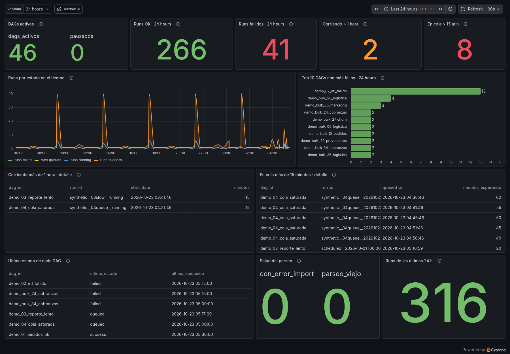
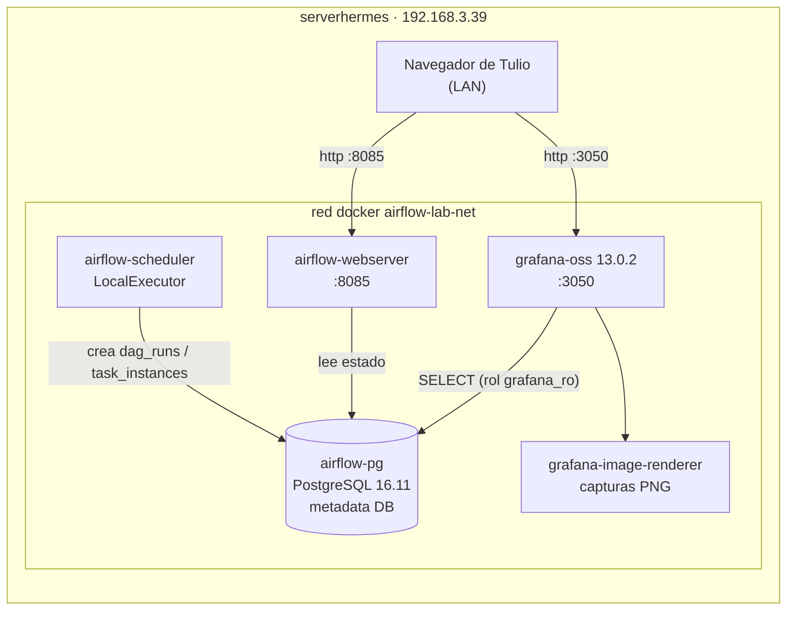

# Airflow 2.8.1 · Visibilidad de DAGs en Grafana

Laboratorio reproducible que responde, en un solo tablero, las cinco preguntas que hoy no
tienen respuesta en el Airflow del cliente:

| # | Pregunta | Panel | Valor en este laboratorio |
|---|---|---|---|
| 1 | ¿Cuántos DAGs hay en total? | `DAGs activos` | **46** |
| 2 | ¿Cuántos se ejecutaron bien? | `Runs OK · 24 h` | **266** |
| 3 | ¿Cuántos fallaron? | `Runs fallidos · 24 h` | **41** |
| 4 | ¿Cuántos llevan corriendo más de 1 hora? | `Corriendo > 1 hora` | **2** (115 y 75 min) |
| 5 | ¿Cuántos están atascados en cola? | `En cola > 15 min` | **8** |

> Cifras de la última verificación (23-oct-2026, 05:35 UTC). El laboratorio sigue vivo y los 46
> DAGs generan ejecuciones, así que los conteos suben con el tiempo: eso es exactamente lo que
> tiene que pasar.



> Los números son los que devolvió Grafana al ejecutar los 12 paneles contra la metadata DB
> real de un Airflow 2.8.1 recién levantado. Reproducibles con `scripts/verify_dashboard.py`.

## Por qué la metadata DB y no StatsD

Airflow expone métricas por StatsD (`dagbag_size`, `dag_processing.import_errors`,
`dagrun.duration.success.<dag_id>`), pero son **counters acumulativos y por evento**: sirven
para latencias y para saber cuántos DAGs se parsearon, no para responder "cuántos fallaron en
las últimas 24 h" ni "cuál lleva más de una hora corriendo". El estado real de cada ejecución
vive en `dag_run` y `task_instance`, dentro de la metadata DB. Grafana las consulta en **solo
lectura**, sin tocar el scheduler ni desplegar nada dentro del Airflow.

Detalle completo de la decisión y de las alternativas descartadas: [`docs/01-arquitectura.md`](docs/01-arquitectura.md).

## Arquitectura del laboratorio



Cinco contenedores, dos puertos publicados (`3050` Grafana, `8085` Airflow), un rol de base de
datos con `SELECT` y `statement_timeout = 30s`. Nada del resto del nodo se toca.

## Arranque

```bash
cd /srv/appdata/airflow-lab

# 1. Arrancar el stack (Postgres → migración + usuario admin → webserver/scheduler → Grafana)
docker compose up -d

# 2. Sembrar el histórico sintético (opcional: sin esto el tablero arranca vacío)
docker exec -i airflow-lab-pg psql -U airflow -d airflow -f - < sql/20_seed_historico.sql
docker exec -i airflow-lab-pg psql -U airflow -d airflow -f - < sql/21_seed_bulk.sql

# 3. Verificar los 12 paneles contra Grafana (devuelve 0 si todos responden)
GRAFANA_PASS=$(grep '^GRAFANA_ADMIN_PASSWORD=' .env | cut -d= -f2) \
  python3 scripts/verify_dashboard.py --ventana "24 hours"
```

- Grafana: <http://192.168.3.39:3050/d/airflow-visibilidad> (lectura anónima; `admin` para editar)
- Airflow: <http://192.168.3.39:8085> (`admin`)
- Credenciales en `.env` (permisos `640`), nunca en el repositorio.

## Verificación (salida real)

```text
GRAFANA  http://127.0.0.1:3050   versión: 13.0.2
DATASOURCE  uid=airflow-pg  type=grafana-postgresql-datasource  db=airflow  user=grafana_ro
            health: OK  Database Connection OK
DASHBOARD   uid=airflow-visibilidad  paneles=12  título=Airflow 2.8.1 · Visibilidad de DAGs
[ OK ]  1 DAGs activos                        filas=1   {"dags_activos": 46, "pausados": 0}
[ OK ]  2 Runs OK · $ventana                  filas=1   {"ok": 266}
[ OK ]  3 Runs fallidos · $ventana            filas=1   {"fallidos": 41}
[ OK ]  4 Corriendo > 1 hora                  filas=1   {"mas_de_1_hora": 2}
[ OK ]  5 En cola > 15 min                    filas=1   {"en_cola_mas_15min": 8}
[ OK ]  6 Runs por estado en el tiempo        filas=25
[ OK ]  7 Top 10 DAGs con más fallos          filas=10
[ OK ]  8 Corriendo más de 1 hora · detalle   filas=2   (115 y 75 minutos)
[ OK ]  9 En cola más de 15 minutos · detalle filas=8
[ OK ] 10 Último estado de cada DAG           filas=46
[ OK ] 11 Salud del parseo                    filas=1   {"con_error_import": 0, "parseo_viejo": 0}
[ OK ] 12 Runs de las últimas 24 h            filas=1   {"runs_24h": 316}
==============================================================================
RESULTADO: 12 paneles verificados, 0 con error
```

## Estructura del repositorio

```text
.
├── compose.yaml                     # stack completo (5 servicios)
├── .env.example                     # variables esperadas (sin valores)
├── dags/                            # 46 DAGs: 6 de historia + 40 de volumen
│   ├── demo_01_pedidos_ok.py        # éxito continuo
│   ├── demo_02_etl_fallido.py       # falla siempre (propósito didáctico)
│   ├── demo_03_reporte_lento.py     # 2 h de proceso → "running > 1 h"
│   ├── demo_04_cola_saturada.py     # max_active_runs=1 → runs en cola
│   ├── demo_05_clientes_diario.py   # fallo controlado 1 de cada 4 días
│   ├── demo_06_ml_features.py       # cada 6 h
│   └── demo_bulk_*_*.py             # 40 DAGs generados, con tasa de fallo propia
├── grafana/
│   ├── dashboards/airflow-visibilidad.json   # dashboard provisionado (12 paneles)
│   └── provisioning/                          # datasource + carga automática
├── sql/
│   ├── 10_rol_grafana_ro.sql        # rol de solo lectura para Grafana
│   ├── 20_seed_historico.sql        # histórico de los 6 DAGs de historia
│   └── 21_seed_bulk.sql             # histórico de los 40 DAGs de volumen
├── scripts/
│   ├── generate_dashboard.py        # genera el JSON del dashboard (SQL versionado)
│   ├── generate_demo_dags.py        # genera los 40 DAGs de volumen
│   └── verify_dashboard.py          # ejecuta cada panel contra Grafana y valida
└── docs/                            # documentación y plan para el cliente
```

## Documentación

| Documento | Para qué |
|---|---|
| [`docs/01-arquitectura.md`](docs/01-arquitectura.md) | Decisiones, alternativas descartadas y por qué cada una |
| [`docs/02-kpis-y-sql.md`](docs/02-kpis-y-sql.md) | Definición exacta de cada KPI, SQL completo, variantes MySQL y 2.9+ |
| [`docs/03-operacion.md`](docs/03-operacion.md) | Runbook: levantar, parar, re-sembrar, diagnosticar |
| [`docs/04-plan-cliente.md`](docs/04-plan-cliente.md) | **Plan de implantación en el cliente** (Airflow en k8s + Grafana en VM) |
| [`docs/05-alertas.md`](docs/05-alertas.md) | Reglas de alerta con umbrales y provisioning YAML |
| [`docs/06-lecciones.md`](docs/06-lecciones.md) | Errores reales encontrados al montarlo y cómo se resolvieron |
| [`PLAN.md`](PLAN.md) | Estado, umbrales y decisiones del nodo (uso interno) |

## Límites honestos de este laboratorio

- **Los datos históricos son sintéticos.** Están marcados con `run_id LIKE 'synthetic__%'`
  y se distinguen de los runs reales del scheduler (que también hay: los 46 DAGs están
  despausados y generan ejecuciones mientras el stack esté arriba).
- **LocalExecutor, no KubernetesExecutor.** El estado `queued` en el cliente suele ser un pod
  `Pending` por falta de recursos; aquí se consigue con `max_active_runs=1`. El panel es
  idéntico, cambia la causa a investigar.
- **Sin TLS y con lectura anónima** hacia el Grafana del laboratorio. Es una decisión de demo
  en LAN; el plan del cliente especifica TLS y autenticación.
- **No hay backup del laboratorio.** Es desechable por diseño (`docker compose down -v`).

## Cómo se retira

```bash
cd /srv/appdata/airflow-lab && docker compose down -v
sudo rm -rf /srv/appdata/airflow-lab   # incluye el histórico sembrado
```
