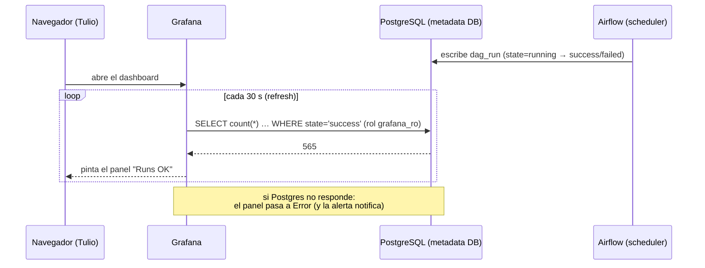

# 01 · Arquitectura y decisiones

## El problema real

El equipo del cliente tiene Airflow 2.8.1 (Python 3.10) sobre Kubernetes y no puede responder
cuatro preguntas básicas sin abrir la UI y contar a mano:

1. cuántos DAGs hay en total,
2. cuántos terminaron bien,
3. cuántos fallaron,
4. cuántos llevan corriendo más de una hora.

El Airflow Web UI responde *por DAG*, no agrega. Y "más de una hora corriendo" no es una
columna que la UI muestre en ningún sitio.

## Decisión 1 · La fuente es la metadata DB, no StatsD

Airflow puede emitir métricas a StatsD (`[metrics] statsd_on = True`). Lo que entrega:

| Métrica | Para qué sirve | Por qué no alcanza |
|---|---|---|
| `dagbag_size` | nº de DAGs que el scheduler parseó | Es un gauge **por instancia de scheduler**: con varios schedulers hay que sumar y deduplicar |
| `dag_processing.import_errors` | ficheros que no compilan | Sí sirve (se usa en el panel de salud del parseo) |
| `dagrun.duration.success.<dag_id>` | cuánto tardó el último run | Es un evento al terminar, no un conteo por estado |
| `ti_failures` / `operator_failures_<op>` | counters acumulativos desde el arranque | No se pueden "ventanear" a 24 h ni descomponer por estado actual |

Ninguna responde "cuántos fallaron en las últimas 24 h" ni "cuál lleva 100 minutos corriendo".
La tabla `dag_run` sí: tiene `state`, `execution_date`, `start_date`, `end_date`, `queued_at`
y `run_type`, por run.

**Consecuencia práctica:** se consulta la metadata DB directamente. No se instala nada dentro
del Airflow del cliente, no se toca el scheduler y no hace falta reiniciar nada.

### Alternativas evaluadas

| Ruta | Qué es | Veredicto |
|---|---|---|
| **A. Grafana → SQL a la metadata DB** | Datasource Postgres/MySQL con usuario de solo lectura | **Elegida.** Un solo componente, responde las 5 preguntas y permite tablas de detalle |
| B. `epoch8/airflow-exporter` (Prometheus) | Plugin que expone `airflow_dag_status`, `airflow_dag_last_status`, `airflow_dag_run_duration` | Complemento útil, pero instala un plugin **dentro** del scheduler (reinicio del Airflow) y no da conteos por ventana ni el detalle de quién está lento |
| C. API REST de Airflow (`/api/v1/dags/~/dagRuns`) | Consultas HTTP paginadas | Cada panel sería una paginación de N páginas: caro y frágil. No es una fuente de métricas |
| D. Vista materializada + cron | Precalcular agregados cada minuto | Plan B si `dag_run` es enorme (>10 M filas) o la DB es un servicio compartido y no admiten consultas analíticas |

La ruta D está documentada en [`02-kpis-y-sql.md`](02-kpis-y-sql.md#rendimiento) por si el
cliente tiene un histórico de años.

## Decisión 2 · Rol de solo lectura, nunca el usuario de Airflow

Grafana conecta con un rol `grafana_ro` que tiene:

- `SELECT` únicamente sobre `dag`, `dag_run`, `task_instance`, `dag_tag`, `import_error`, `slot_pool`;
- **no** tiene acceso a `serialized_dag` (contiene el código de los DAGs), ni a `log`, ni a `ab_user`
  (hashes de contraseñas);
- `statement_timeout = 30s` e `idle_in_transaction_session_timeout = 60s`: un panel mal escrito
  no puede colgar la metadata DB que el scheduler necesita para avanzar;
- `default_transaction_read_only = on`: aunque alguien lo intente, ese rol no escribe.

DDL completo en [`../sql/10_rol_grafana_ro.sql`](../sql/10_rol_grafana_ro.sql).

## Decisión 3 · Dashboard como código

El JSON del dashboard **no se dibuja a mano**: lo genera
[`scripts/generate_dashboard.py`](../scripts/generate_dashboard.py), donde el SQL de cada panel
es texto versionado. Ventajas que se notan a la semana:

- revisar un cambio de query en un `git diff`;
- regenerar el dashboard completo si cambia un umbral;
- el mismo JSON sirve para el laboratorio y para el cliente (solo cambia el `uid` del datasource).

Grafana lo carga por provisioning: el fichero aparece en la carpeta y el panel existe en 30 s.

## Decisión 4 · Qué se mide y qué no

| Se mide | No se mide (y por qué) |
|---|---|
| DAGs activos (`dag.is_active`) sin subdags | DAGs borrados del repo: Airflow los desactiva, así que "total" = lo que el DagBag tiene cargado |
| Runs por estado en una ventana parametrizable | Duración media por tarea: se puede añadir, pero no es lo que pidió el cliente |
| Ejecuciones corriendo por encima de 1 h | "DAG atascado" en sentido estricto: un run de 3 h puede ser legítimo (sensores, backfills) |
| Cola con más de 15 min | Métricas de infraestructura (CPU de workers, pods Pending): eso es del clúster, no de Airflow |
| Último estado por DAG y salud del parseo | SLA por DAG: requiere definir SLA por negocio, va en una segunda fase |

El panel de cola merece un párrafo aparte: en Kubernetes, un `dag_run` en `queued` que no
avanza suele ser un **pod `Pending`** (sin CPU/memoria, PVC sin bound, imagen que no baja,
`nodeSelector`/`toleration` mal puestos). Airflow no lo dice: el run simplemente espera. Por eso
el panel está desde el primer día, aunque el cliente no lo haya pedido.

## Cómo viaja un dato: el recorrido de una consulta

No hay ningún agente enviando métricas. Grafana pregunta, Postgres responde, el panel dibuja.



Consecuencia: el tablero **no guarda nada**; es un visor. La persistencia de los datos es la
metadata DB de Airflow y la retención la decide su política de purga
(`airflow db clean --clean-before-timestamp`), no Grafana.

## Estructura del laboratorio

```text
                 ┌──────────────────────────── red docker airflow-lab-net ───────────────────────────┐
 navegador ──►   │  grafana-oss 13.0.2 :3050  ──(SELECT, rol grafana_ro)──►  airflow-pg (Postgres 16)  │
 (LAN)           │        │                                                              ▲              │
                 │        └──► grafana-image-renderer (PNG para documentación)             │              │
                 │                                                                      │              │
                 │  airflow-webserver :8085 ──────────────────────────────────────────► │              │
                 │  airflow-scheduler (LocalExecutor) ────────────────────────────────► │              │
                 └──────────────────────────────────────────────────────────────────────────────────────┘
```

| Servicio | Imagen | Función |
|---|---|---|
| `airflow-pg` | `postgres:16.11-alpine` | metadata DB (la fuente de verdad) |
| `airflow-init` | `apache/airflow:2.8.1-python3.10` | `db migrate` + usuario admin (one-shot) |
| `airflow-webserver` | idem | UI en `:8085` |
| `airflow-scheduler` | idem | LocalExecutor: ejecuta las tareas en el propio contenedor |
| `grafana` | `grafana/grafana-oss:13.0.2` | dashboard + datasource provisionados |
| `grafana-renderer` | `grafana/grafana-image-renderer:v5.12.8` | genera PNG del dashboard (el navegador del host no arranca: le faltan librerías) |

## Por qué estas versiones

- **Airflow 2.8.1 / Python 3.10**: es la versión declarada por el cliente. Importa: en Airflow
  2.9+ la columna `dag_run.execution_date` se llama `logical_date` y todas las queries cambian.
  El SQL del repo trae la variante comentada.
- **Postgres 16.11**: el motor más habitual con Airflow. Si el cliente usa MySQL, el SQL tiene
  su variante documentada (no hay `FILTER (WHERE …)` ni índices parciales).
- **Grafana 13.0.2**: la OSS estable al momento del montaje. El dashboard usa `schemaVersion 39`
  y `grafana-postgresql-datasource` como tipo de datasource (en Grafana ≥ 11 el id del plugin
  dejó de ser `postgres`).

## Lo que este laboratorio **no** prueba

- **KubernetesExecutor**: el `queued` de este lab viene de `max_active_runs=1`, no de pods
  Pending. El panel es el mismo; la investigación posterior no.
- **Múltiples schedulers**: con HA, `dagbag_size` se repite por instancia. Aquí hay uno solo.
- **Volumen de producción**: 4.338 filas en `dag_run`. Un cliente con años de historia tiene
  millones; ver la sección de rendimiento en `02-kpis-y-sql.md`.
- **Seguridad**: el Grafana del lab permite lectura anónima y habla HTTP plano, a propósito,
  para poder demostrarlo en LAN. El plan del cliente (`04-plan-cliente.md`) especifica TLS,
  autenticación y segmentación.
