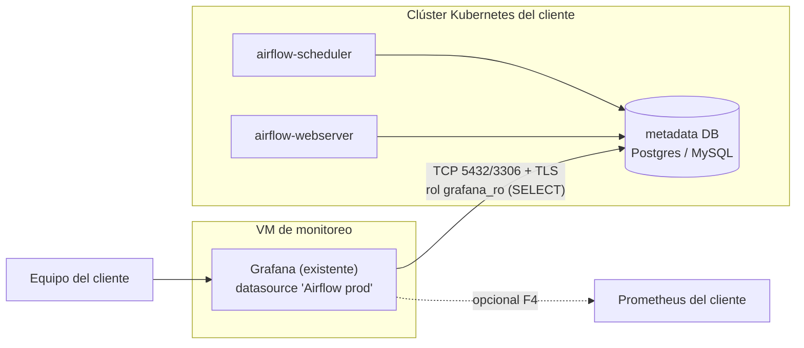

# 04 · Plan de implantación en el cliente

> Cliente con **Airflow 2.8.1 (Python 3.10) sobre Kubernetes** y **Grafana en una máquina
> virtual**. El laboratorio de este repositorio es la maqueta validada; este documento es el
> trabajo real: qué se pide, qué se toca, en qué orden, con qué riesgos y cómo se acepta.

## 0 · Resumen ejecutivo

| | |
|---|---|
| **Objetivo** | Un tablero en el Grafana existente que responda: total de DAGs, runs OK, runs fallidos, corriendo > 1 h y cola atascada |
| **Cambios en el Airflow del cliente** | **Ninguno.** No se reinicia el scheduler, no se instala ningún plugin, no se toca el código de los DAGs |
| **Cambios en la metadata DB** | Un rol `grafana_ro` de solo lectura + (si hace falta) un índice `CONCURRENTLY` |
| **Cambios en Grafana** | Un datasource y un dashboard, ambos por API/provisioning (versionables) |
| **Esfuerzo estimado** | **3-4 jornadas** de trabajo efectivo, repartidas en 5 fases |
| **Riesgo principal** | Que la VM de Grafana no tenga ruta a la metadata DB (se resuelve en F0, antes de prometer fechas) |
| **Ventana de producción** | Solo F1 necesita una ventana corta (crear el rol); el resto es aditivo |

## 1 · Arquitectura propuesta



**Por qué el Grafana de la VM y no uno nuevo en el clúster:** ya existe, ya lo mantiene
alguien, ya tiene backups y ya es donde el equipo mira las cosas. Desplegar un Grafana nuevo
en el clúster es fácil pero crea un segundo silo que nadie administra.

**Condición para que funcione:** la VM tiene que llegar a la metadata DB. Si no llega, hay tres
alternativas, en este orden:

| Alternativa | Cuándo | Coste |
|---|---|---|
| Abrir la DB al IP de la VM (firewall + `pg_hba`/grants) | DB con IP propia y equipo de redes disponible | Bajo |
| **Túnel SSH** de la VM al clúster como unidad `systemd` (`-L 15432:db:5432`) | La DB solo es alcanzable desde dentro del clúster | Medio, y hay que monitorizar el túnel |
| Grafana dentro del clúster (Helm) expuesto por la VM como proxy | No se permite abrir la DB a la VM | Alto (otro Grafana que mantener) |

Si la DB es gestionada (RDS/Cloud SQL), lo normal es la primera: *allowlist* del IP de la VM +
`ssl mode=require`. Eso hay que pedirlo al equipo de cloud, y suele ser el plazo más largo del
proyecto — por eso es lo primero que se pregunta.

## 2 · Fases

### F0 · Descubrimiento (2-3 h, sin tocar nada)

Todo lo de esta fase es **solo lectura**. Su salida es un documento de una página que confirma
o corrige las estimaciones.

**En el clúster:**

```bash
# versión real (no la del ticket)
kubectl exec -n <ns> deploy/airflow-scheduler -- airflow version
kubectl exec -n <ns> deploy/airflow-scheduler -- airflow config get-value database sql_alchemy_conn
# ^ devuelve credenciales: NO pegarlas en un chat. Guardar solo host/puerto/motor.
kubectl get pods -n <ns> -o wide
kubectl get svc,pvc -n <ns>
kubectl exec -n <ns> deploy/airflow-scheduler -- airflow config get-value core executor
kubectl exec -n <ns> deploy/airflow-scheduler -- airflow config get-value metrics statsd_on
```

**En la metadata DB** (con un usuario de lectura temporal, o vía el scheduler):

```sql
SELECT version();
SELECT relname, n_live_tup, pg_size_pretty(pg_total_relation_size(relid)) AS tamaño
FROM pg_stat_user_tables
WHERE relname IN ('dag','dag_run','task_instance') ORDER BY 3 DESC;

SELECT indexname, indexdef FROM pg_indexes WHERE tablename='dag_run';

SELECT count(*), min(execution_date), max(execution_date) FROM dag_run;
```

**En la VM de Grafana:**

```bash
grafana-server -v || grafana --version
curl -s http://localhost:3000/api/health
# ¿tiene Prometheus ya configurado?
curl -s -u admin:*** http://localhost:3000/api/datasources | jq -r '.[] | "\(.type) \(.name)"'
# ¿llega a la DB de Airflow? (esto decide la arquitectura)
nc -zv <db-host> 5432
```

**Entregable:** tabla con versión, motor y tamaño de la DB, si hay Prometheus, si hay ruta de
red, y la decisión de alternativa (directa / túnel / Grafana en k8s).

### F1 · Acceso a datos (0.5-1 jornada)

1. Crear el rol (adaptar a MySQL si aplica — ver `02-kpis-y-sql.md`):

   ```sql
   CREATE ROLE grafana_ro LOGIN PASSWORD '<generada>';
   ALTER ROLE grafana_ro SET statement_timeout = '30s';
   ALTER ROLE grafana_ro SET default_transaction_read_only = on;
   GRANT CONNECT ON DATABASE airflow TO grafana_ro;
   GRANT USAGE ON SCHEMA public TO grafana_ro;
   GRANT SELECT ON dag, dag_run, task_instance, dag_tag, import_error, slot_pool TO grafana_ro;
   ```

2. Si `dag_run` supera ~2 M filas, pedir el índice (una sola vez, sin bloquear):

   ```sql
   CREATE INDEX CONCURRENTLY idx_dag_run_state_execution_date ON dag_run (state, execution_date);
   ```

3. Guardar la contraseña **en la VM, en el almacén del cliente**: `/etc/grafana/airflow-ro.pw`
   con `640 root:grafana`, o en su gestor de secretos (Vault/Sealed Secret). Nunca en el chat,
   nunca en el JSON del dashboard, nunca en el repositorio.

4. Verificar desde la VM con el rol nuevo:

   ```bash
   PGPASSWORD=$(cat /etc/grafana/airflow-ro.pw) psql -h <db> -U grafana_ro -d airflow \
     -c "select count(*) from dag_run;"
   ```

**Criterio de aceptación:** ese `count(*)` responde en < 1 s y **no** se puede ejecutar un
`DELETE`/`UPDATE` con ese rol (probarlo: debe fallar).

### F2 · Datasource + dashboard (0.5 jornada)

1. Datasource por API (no a mano en la UI, para que quede registrado):

   ```bash
   curl -s -u admin:*** -X POST http://<vm>:3000/api/datasources \
     -H 'Content-Type: application/json' -d '{
       "name":"Airflow prod","uid":"airflow-pg-prod","type":"grafana-postgresql-datasource",
       "access":"proxy","url":"<db-host>:5432","database":"airflow","user":"grafana_ro",
       "jsonData":{"sslmode":"require","postgresVersion":1600,"timescaledb":false},
       "secureJsonData":{"password":"<leída del fichero>"}}'
   ```

2. Importar el dashboard del repo, cambiando el `uid` del datasource:

   ```bash
   python3 scripts/generate_dashboard.py \
     | sed 's/"uid": "airflow-pg"/"uid": "airflow-pg-prod"/' > /tmp/dash.json
   # envolver en {"dashboard": …, "overwrite": true, "folderUid": "<carpeta Airflow>"} y POST /api/dashboards/db
   ```

3. Verificar los 12 paneles con el script del repo apuntando a la VM:

   ```bash
   GRAFANA_URL=http://<vm>:3000 GRAFANA_USER=admin GRAFANA_PASS=*** \
     DASHBOARD_UID=airflow-visibilidad-prod python3 scripts/verify_dashboard.py
   ```

**Criterio de aceptación:** `12 paneles verificados, 0 con error`, y los números cuadran con la
consulta directa a la DB (ver "Cómo validar los números" en `02-kpis-y-sql.md`).

### F3 · Alertas (0.5 jornada)

Cuatro reglas, umbrales y YAML en [`05-alertas.md`](05-alertas.md). Necesita que el cliente
decida el canal (email, Slack, Teams, PagerDuty) y quién recibe qué. Recomendación: empezar con
**una sola** alerta en producción (corriendo > 1 h), que es la que hoy les cuesta dinero, y
añadir las demás tras dos semanas de observación.

### F4 · Opcional · Prometheus / InfluxDB (1-2 jornadas)

> Diseño ya escrito y congelado para cuando llegue el caso: [`08-fase2-externalizacion.md`](08-fase2-externalizacion.md).
> **No forma parte del MVP**: se ofrece aparte, con alcance y precio propios.

Solo si el cliente ya tiene Prometheus y quiere las métricas junto al resto:

- desplegar `epoch8/airflow-exporter` 1.5.x (compatible Airflow 2.x) como sidecar/deployment;
- scrapear `/admin/metrics/` con un `ServiceMonitor`;
- añadir al tablero: `scheduler_heartbeat`, `executor.open_slots`, `pool.running_slots`,
  `dagbag_size`.

Esto **sí** toca el Airflow (plugin + reinicio del scheduler), por eso va aparte y es opcional.

### F5 · Cierre y transferencia (0.5 jornada)

- Dashboard y datasource documentados en el repo del cliente (no solo clicks en la UI).
- Runbook: qué significa cada panel, qué hacer cuando se pone rojo, a quién avisar.
- Sesión de 1 h con el equipo: cómo cambiar la ventana, cómo añadir un panel, cómo se actualiza
  el dashboard desde el repositorio.
- Checklist de aceptación firmado.

## 3 · Criterios de aceptación (Definition of Done)

1. El dashboard responde las 5 preguntas con datos reales de producción.
2. Los números coinciden con la consulta SQL directa a la metadata DB (tolerancia: 0).
3. El rol `grafana_ro` es de solo lectura y tiene `statement_timeout` (probado).
4. Ningún cambio en el Airflow: mismo número de réplicas, sin reinicios, mismo `airflow.cfg`.
5. El dashboard es reproducible desde el repositorio (no solo existe en la UI).
6. Existe runbook y el equipo sabe qué hacer cuando una alerta salta.

## 4 · Riesgos

| Riesgo | Probabilidad | Impacto | Mitigación |
|---|---|---|---|
| La VM no tiene ruta a la metadata DB | Alta | Bloquea todo | F0 lo detecta en la primera hora; alternativas definidas arriba |
| Permisos: el equipo de DB no deja crear roles | Media | Bloquea F1 | Pedirlo en F0; alternativa: usuario existente + `GRANT SELECT` temporal |
| `dag_run` con millones de filas y paneles lentos | Media | Medio | Medir en F0; índice `CONCURRENTLY` o vista materializada |
| Grafana de la VM sin capacidad de añadir datasources (política corporativa) | Media | Medio | Que lo añada su equipo con el JSON/curl ya preparado |
| Airflow con 2+ schedulers o `dag.is_active` semántica distinta | Baja | Bajo | Revalidar panel 1 en F0 contra el esquema real |
| El cliente migra a Airflow 3 a mitad del proyecto | Media | Medio | Ya está documentado el cambio `execution_date` → `logical_date` |
| Se exponen credenciales en la demo/chat | Baja | Alto | Contraseñas solo por fichero y por el almacén del cliente |

## 5 · Decisiones que hay que cerrar con el cliente

1. **Grafana**: ¿usamos el de la VM (recomendado) o desplegamos uno en el clúster?
2. **"Total de DAGs"**: ¿activos del DagBag, o activos + pausados? (recomendado: activos, y los
   pausados como número aparte, que es como está el laboratorio).
3. **"Fallidos"**: ¿solo estado `failed` del `dag_run`, o también `upstream_failed`?
   (recomendado: sí, incluirlos, son fallos operativos).
4. **Ventana por defecto**: 24 h (recomendado) con selector 1 h / 6 h / 24 h / 7 d / 30 d.
5. **Umbral de "lento"**: 1 h es el que pidieron. ¿Hay DAGs conocidos como lentos que deban
   excluirse del panel? (recomendado: lista de exclusión, no subir el umbral global).
6. **Canal de alertas** y quién las recibe, en horario y fuera de horario.
7. **Índice en `dag_run`**: sí/no, según el tamaño medido en F0.
8. **F4 (Prometheus)**: ¿dentro o fuera de este alcance?

## 6 · Qué NO incluye

- SLA por DAG, notificaciones por DAG ni gestión de incidencias.
- Métricas de infraestructura del clúster (CPU, pods Pending, PVC). Se referencian en el panel
  de cola, pero se resuelven con el monitoreo del clúster.
- Retención/purga de la metadata DB (Airflow no la trae y los clientes suelen necesitarla).
- Migración de Airflow a 3.x.
- Alta disponibilidad del Grafana de la VM.

## 7 · Guion de la demo (10 minutos)

1. **Minuto 0-1** · abrir el tablero y leer los 5 números en voz alta. Nada más.
2. **Minuto 1-3** · la pregunta que no pueden contestar hoy: "¿qué DAG lleva más de una hora
   corriendo?" → tabla del panel 8, con minutos y `dag_id`.
3. **Minuto 3-5** · "¿y qué está atascado antes de empezar?" → panel 9 y la explicación de que en
   k8s eso es un pod Pending.
4. **Minuto 5-7** · cambiar la ventana a 7 días delante de ellos: el mismo tablero, otra escala.
5. **Minuto 7-9** · enseñar que el dashboard es código (`git log` del JSON) y que el rol de
   Grafana no puede escribir en su base.
6. **Minuto 9-10** · las 8 decisiones de la sección 5 y la fecha de F0.

Lo que **no** hay que hacer en la demo: enseñar el laboratorio como si fuera su entorno. Los
datos son sintéticos y hay que decirlo en la primera frase, o la credibilidad se cae en la
segunda.
