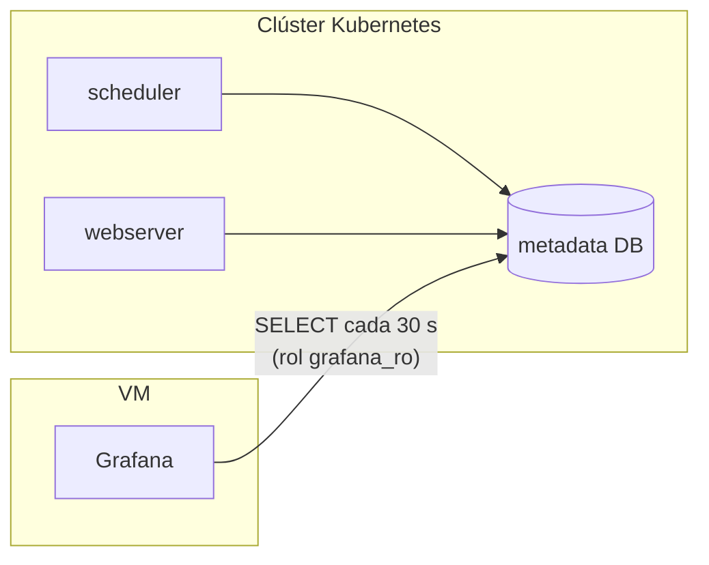
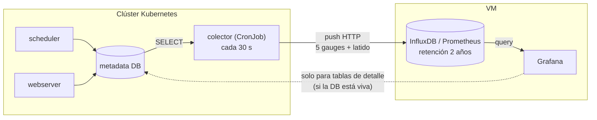

# 08 · Fase 2 · Externalizar las métricas a un TSDB

> **Estado: NO implementada — decisión tomada, no descartada.** El MVP funciona leyendo la
> metadata DB directamente. Esta fase solo se activa cuando el cliente pide una de las dos cosas
> que la justifican (ver "Disparadores"). Se documenta ahora para que la conversación no empiece
> de cero y para que el día que se haga no haya que re-diseñarla.

## El problema que resuelve

Hoy el tablero lee la metadata DB en cada refresco. Consecuencias conocidas:

1. Si la DB (que vive **dentro del clúster**) cae, el tablero se queda ciego.
2. La historia disponible es la que el cliente no haya purgado. Si algún día purgan `dag_run`,
   la historia desaparece.
3. Cada refresco (12 paneles × cada 30 s) son consultas sobre la base que el scheduler usa para
   avanzar. Con `dag_run` de millones de filas, eso se nota.

## Los dos estados, dibujados

**Hoy (MVP):**



**Fase 2 (con TSDB):**



Versión PNG para diapositivas: [`img/fase2-arquitectura.png`](img/fase2-arquitectura.png).

La diferencia clave: **el colector está dentro** (es el único que puede leer la DB), pero **el
almacén está fuera**. Si el clúster desaparece, InfluxDB y Grafana siguen contando la última foto
y todo el histórico.

## Modelo de métricas

Cinco *gauges* globales, un latido, y opcionalmente un gauge por DAG.

| Métrica | Tipo | Etiquetas | De dónde sale |
|---|---|---|---|
| `airflow_dags_active` | gauge | — | `count(*) FROM dag WHERE is_active AND NOT is_subdag` |
| `airflow_runs_success` | gauge | `window="24h"` | `count(*) FROM dag_run WHERE state='success' AND …` |
| `airflow_runs_failed` | gauge | `window="24h"` | `count(*) … state='failed' …` |
| `airflow_runs_running` | gauge | — | `count(*) … state='running'` |
| `airflow_runs_running_over_1h` | gauge | — | `… AND start_date < now()-interval '1 hour'` |
| `airflow_runs_queued_over_15m` | gauge | — | `… AND queued_at < now()-interval '15 minutes'` |
| `airflow_dag_running_seconds` | gauge | `dag_id` | segundos del run más viejo en `running` por DAG |
| `airflow_collector_last_success_timestamp` | gauge | — | **latido**: epoch de la última recolección correcta |

Reglas que no se negocian:

- **Nunca etiquetar por `run_id`.** Cardinalidad infinita y el TSDB se cae.
- **`dag_id` sí** es aceptable (decenas o cientos), y es lo que permite el panel de detalle.
- Los conteos por ventana son gauges, no counters: se recalculan cada ciclo. Eso es correcto para
  "cuántos fallaron en 24 h" y **no** sirve para `rate()` — si algún día se quiere tasa por
  segundo, ahí sí hace falta un counter incremental.

### Ejemplo InfluxDB (line protocol)

```text
airflow,dag_id=all dags_active=46i,runs_success=565i,runs_failed=123i,runs_running=3i,\
runs_running_over_1h=1i,runs_queued_over_15m=0i,collector_last_success=1792737600i 1792737600000000000
```

### Ejemplo Prometheus (Pushgateway)

```bash
curl --data-binary @- http://pushgateway:9091/metrics/job/airflow_kpis <<'EOF'
# TYPE airflow_runs_failed gauge
airflow_runs_failed 123
# TYPE airflow_collector_last_success_timestamp gauge
airflow_collector_last_success_timestamp 1792737600
EOF
```

## Esqueleto del colector (~40 líneas, no activo)

```python
# collector/collector.py  — corre DENTRO del clúster, cada 30 s (CronJob con schedule "*/1 * * * *")
import os, time, requests, psycopg2

KPI_SQL = {
    "dags_active": "SELECT count(*) FROM dag WHERE is_active AND NOT is_subdag",
    "runs_success": "SELECT count(*) FROM dag_run WHERE state='success' "
                    "AND execution_date > now()-interval '24 hours'",
    "runs_failed":  "SELECT count(*) FROM dag_run WHERE state='failed' "
                    "AND execution_date > now()-interval '24 hours'",
    "runs_running": "SELECT count(*) FROM dag_run WHERE state='running'",
    "runs_running_over_1h": "SELECT count(*) FROM dag_run WHERE state='running' "
                            "AND start_date < now()-interval '1 hour'",
    "runs_queued_over_15m": "SELECT count(*) FROM dag_run WHERE state='queued' "
                            "AND queued_at < now()-interval '15 minutes'",
}

def main() -> None:
    with psycopg2.connect(os.environ["AIRFLOW_DB_URL"]) as conn:   # usuario de SOLO lectura
        with conn.cursor() as cur:
            values = {}
            for name, sql in KPI_SQL.items():
                cur.execute(sql)
                values[name] = int(cur.fetchone()[0])
    values["collector_last_success"] = int(time.time())

    line = "airflow,dag_id=all " + ",".join(f"{k}={v}i" for k, v in values.items())
    url = f'{os.environ["INFLUX_URL"]}/api/v2/write?org={os.environ["INFLUX_ORG"]}' \
          f'&bucket={os.environ["INFLUX_BUCKET"]}&precision=s'
    r = requests.post(url, data=line.encode(), timeout=10,
                      headers={"Authorization": f'Token {os.environ["INFLUX_TOKEN"]}'})
    r.raise_for_status()          # si falla, el CronJob queda en Error y se ve en k8s

if __name__ == "__main__":
    main()
```

Notas de implementación:

- El usuario de la DB es el mismo `grafana_ro`: el colector tampoco necesita escribir.
- El token de Influx va en un `Secret`, nunca en el `CronJob` ni en el repositorio.
- El `CronJob` debe tener `concurrencyPolicy: Forbid` y `backoffLimit: 1`.
- **Lo que casi todos olvidan:** el colector puede morir en silencio y el dashboard seguir
  mostrando la última línea plana como si todo estuviera bien. De ahí el latido: una alerta sobre
  `time() - airflow_collector_last_success_timestamp > 300` es obligatoria, no opcional.

## Qué cambia en el dashboard

El tablero pasa a ser **híbrido**:

| Panel | Fuente en Fase 2 |
|---|---|
| DAGs activos, OK, fallidos, corriendo, cola | TSDB (siempre disponible) |
| Serie temporal por estado | TSDB |
| Top 10 DAGs con más fallos | TSDB con `dag_id` (o DB) |
| Tablas de detalle (`run_id`, minutos, fechas) | **DB** — si la DB está caída, se muestran vacías con aviso |
| Salud del parseo | DB (o un gauge propio si se quiere history) |

Es decir: los números sobreviven a la caída; el detalle fino no. Eso hay que decirlo tal cual.

## Alternativas y coste

| Variante | Añade | Cuándo elegirla |
|---|---|---|
| **A · Colector + InfluxDB** | Una base + un bucket + retención | No tienen Prometheus y quieren historia simple |
| **B · Colector + Pushgateway + Prometheus** | Un `job` más en su Prometheus | **Ya tienen Prometheus en la VM** (caso más barato) |
| **C · `airflow-exporter` en el scheduler** | Plugin + reinicio de Airflow | Nunca en fase 1; solo si además quieren métricas internas del scheduler |

Coste estimado de A o B: **1-2 jornadas** (colector, secretos, CronJob, dashboard nuevo,
pruebas de caída). No incluye la retención a largo plazo del cliente.

## Disparadores para activarla

Se hace cuando el cliente dice **una** de estas frases:

1. "Quiero ver qué pasó hace seis meses" / "necesitamos historia de más de X".
2. "Quiero el tablero aunque el clúster esté caído".
3. (Técnico) La consulta del panel tarda más de 2-3 s y `dag_run` pasa de unos pocos millones de
   filas, y no aceptan réplica de lectura.

Si no dice ninguna, **no se hace**: se queda documentada como aquí.

## Criterios de aceptación (cuando se implemente)

1. Con **Postgres detenido**, el dashboard de TSDB sigue mostrando los 5 números y la serie
   histórica. Comprobado y capturado.
2. El retardo entre la realidad y el panel es **< 90 s** (2 ciclos).
3. La alerta de latido dispara cuando el colector lleva 5 minutos sin escribir.
4. Los números del TSDB y los de la DB coinciden (± 1 unidad por desfase del ciclo).
5. La retención está declarada y probada (consulta de un dato de hace N días).
6. El token vive en un `Secret`; el colector usa el rol de solo lectura.

## Decisión registrada

**No entra en el MVP.** Se ofrece como fase 2 con alcance y precio propios. Motivo: el MVP ya
responde las 5 preguntas, y esta fase duplica la infraestructura de almacenamiento antes de que el
cliente haya pedido historia o resiliencia. La objeción "y si se cae el clúster" se cubre en el
MVP con la alerta en estado *Error* y un chequeo externo del webserver
(ver [`07-bd-en-k8s.md`](07-bd-en-k8s.md), escalón 0).
