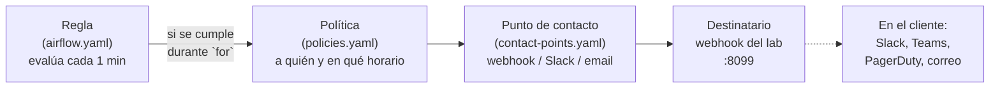

# 10 · Cadena de alertas: regla → contacto → aviso

Una regla que evalúa pero no avisa a nadie es media alerta. Aquí está la otra mitad, montada y
probada en el laboratorio.

## Las cuatro piezas



| Pieza | Fichero | Estado en el laboratorio |
|---|---|---|
| 4 reglas | `grafana/provisioning/alerting/airflow.yaml` | provisionadas, `health=ok` |
| Punto de contacto | `grafana/provisioning/alerting/contact-points.yaml` | `webhook-laboratorio` → `http://webhook:8099/alerta` |
| Política | `grafana/provisioning/alerting/policies.yaml` | todo va al webhook, `group_wait: 10s`, `repeat_interval: 1h` |
| Destinatario | `webhook/server.py` (contenedor `webhook`) | <http://192.168.3.39:8099> lista las alertas recibidas |

## La prueba que se hizo (y su resultado)

Se creó una regla temporal que siempre se cumple (`count(*) FROM dag > 0`) con `for: 0s`, para no
depender de que un DAG se rompa justo en ese momento:

```bash
curl -s -u admin:*** -X POST http://127.0.0.1:3050/api/v1/provisioning/alert-rules \
  -H 'Content-Type: application/json' -d '{
    "uid":"test-notificacion",
    "title":"PRUEBA · cadena de alertas extremo a extremo",
    "condition":"C","folderUID":"airflow-folder","orgID":1,"ruleGroup":"pruebas",
    "noDataState":"OK","execErrState":"OK","for":"0s",
    "annotations":{"summary":"Prueba de la cadena: regla → contacto → webhook"},
    "labels":{"severity":"info"},
    "data":[
      {"refId":"A","relativeTimeRange":{"from":600,"to":0},"datasourceUid":"airflow-pg",
       "model":{"editorMode":"code","format":"table","rawQuery":true,
                "rawSql":"SELECT count(*) AS dags FROM dag WHERE is_active"}},
      {"refId":"B","datasourceUid":"__expr__",
       "model":{"type":"reduce","expression":"A","reducer":"last"}},
      {"refId":"C","datasourceUid":"__expr__",
       "model":{"type":"threshold","expression":"B",
                "conditions":[{"evaluator":{"type":"gt","params":[0]},"operator":{"type":"and"},
                               "query":{"params":["B"]},"reducer":{"type":"last"}}]}}
    ]}'
```

Resultado real, **60 segundos** después (evaluación del grupo + `group_wait`):

```json
[
  {
    "recibido": "2026-10-24T03:16:45+00:00",
    "titulo": "[FIRING:1] PRUEBA · cadena de alertas extremo a extremo info (prueba Airflow)",
    "estado": "firing",
    "alertas": [
      {
        "estado": "firing",
        "nombre": "PRUEBA · cadena de alertas extremo a extremo",
        "severidad": "info",
        "resumen": "Prueba de la cadena: regla → contacto → webhook",
        "inicio": "2026-10-24T03:16:30Z"
      }
    ]
  }
]
```

Y el log del receptor:

```text
[2026-10-24T03:16:45+00:00] firing · 1 alerta(s) · PRUEBA · cadena de alertas extremo a extremo
```

Después se borró la regla de prueba (`DELETE /api/v1/provisioning/alert-rules/test-notificacion`,
HTTP 204) y quedaron las 4 reales.

## Cómo cambiar el destinatario (cliente)

Solo cambia el *tipo* y los *settings* del receptor; las reglas y la política se quedan igual.

**Slack:**

```yaml
contactPoints:
  - orgId: 1
    name: airflow-oncall
    receivers:
      - uid: airflow-oncall
        type: slack
        settings:
          url: https://hooks.slack.com/services/XXX/YYY/ZZZ   # ← en un Secret
          title: Airflow
          text: "{{ .CommonAnnotations.summary }}"
```

**Correo:**

```yaml
      - uid: airflow-email
        type: email
        settings:
          addresses: equipo-datos@cliente.com;guardia@cliente.com
          singleEmail: false
```

**PagerDuty / Teams / Opsgenie:** mismo patrón (`type: pagerduty`, `type: teams`), con su
integración key en `secureSettings`.

> El webhook del laboratorio es solo para demostrar. En el cliente el receptor vive fuera del
> clúster o en su herramienta de guardia.

## Silencios (mute timings)

Sin esto, un mantenimiento programado dispara una tormenta de avisos y el equipo deja de mirarlos:

```yaml
muteTimes:
  - orgId: 1
    name: mantenimiento-cluster
    time_intervals:
      - weekdays: ["saturday", "sunday"]
        times:
          - start_time: "02:00"
            end_time: "05:00"
```

## Lo que estas alertas **no** pueden hacer

Las reglas de la vía A consultan la metadata DB. Si esa base cae:

- la regla pasa a **Error** (por `execErrState: Error`) y **sí notifica** — eso está cubierto;
- pero no puede decir *por qué* ni *cuánto*.

Para "el clúster está caído" hace falta una señal que viva **fuera**:

1. **Chequeo externo** al `/health` del webserver (desde la VM o un servicio tipo Uptime Kuma).
2. **Latido del colector** en Influx (vía B):

```flux
from(bucket: "airflow")
  |> range(start: -15m)
  |> filter(fn: (r) => r._measurement == "airflow_kpi" and r._field == "collector_last_success")
  |> last()
  |> map(fn: (r) => ({ r with _value: float(v: now()) - float(v: r._collector_last_success) }))
  // alertar si _value > 300
```

Esa regla se evalúa contra InfluxDB, no contra la metadata DB: por eso sigue funcionando cuando el
clúster ya no está.

## Verificación rápida del estado de las alertas

```bash
PW=$(grep '^GRAFANA_ADMIN_PASSWORD=' .env | cut -d= -f2)
# reglas y su estado
curl -s -u admin:$PW http://127.0.0.1:3050/api/prometheus/grafana/api/v1/rules \
  | python3 -c 'import sys,json; d=json.load(sys.stdin); [print(r["name"], r["state"], r["health"]) for g in d["data"]["groups"] for r in g["rules"]]'
# puntos de contacto
curl -s -u admin:$PW http://127.0.0.1:3050/api/v1/provisioning/contact-points
# alertas recibidas en el laboratorio
curl -s http://127.0.0.1:8099/json | head -40
```
