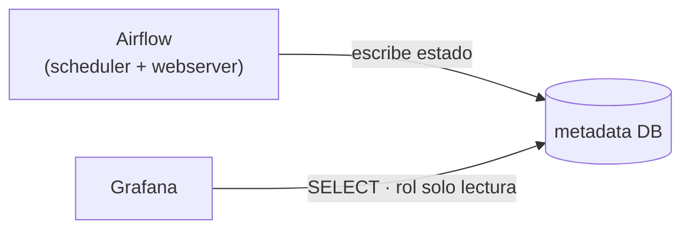
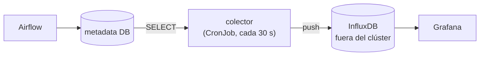
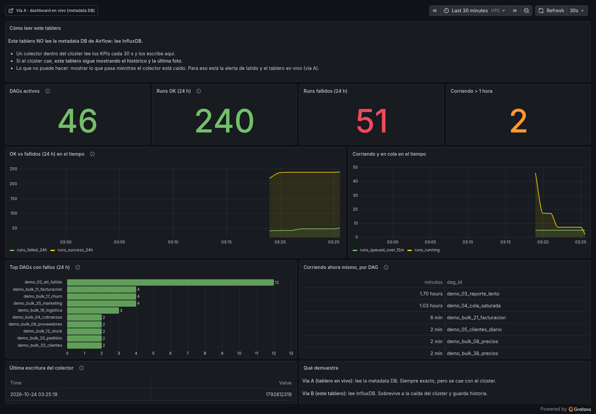
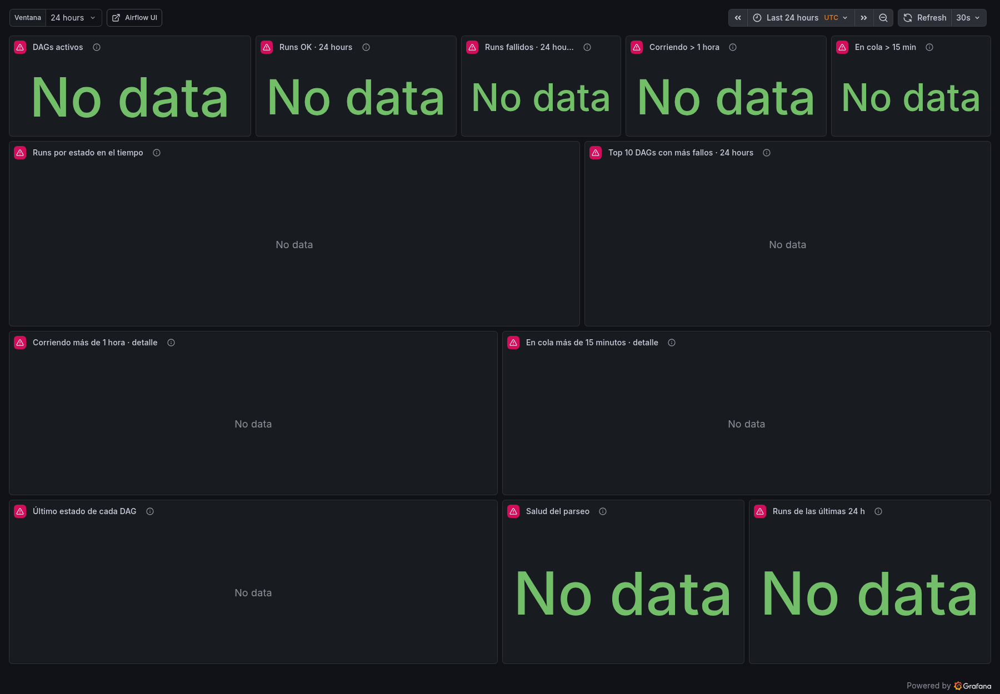
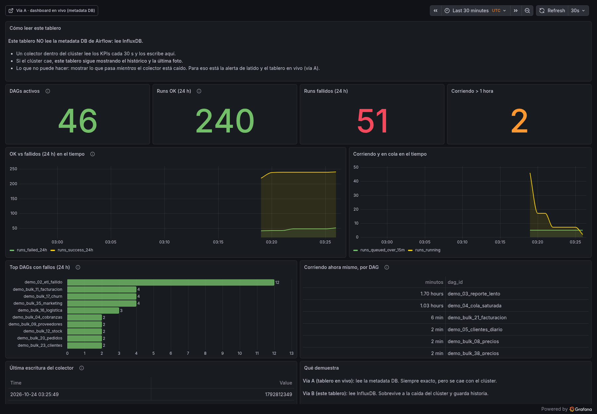

# 12 · Propuesta: dos opciones, con números

> Versión para presentar. La maqueta está en vivo y el deck es
> [`presentacion-dos-opciones.pptx`](presentacion-dos-opciones.pptx) (10 diapositivas).

## Resumen en cinco líneas

1. Hoy el cliente no sabe cuántos DAGs tiene, cuántos fallaron ni cuál lleva una hora colgado.
2. Se resuelve con un tablero de Grafana que lee el estado de Airflow, **sin tocar Airflow**.
3. Está probado en un laboratorio real: Airflow 2.8.1, 46 DAGs, 12 paneles, 0 errores.
4. Hay **dos formas** de hacerlo, y la diferencia es qué pasa cuando el clúster se cae.
5. Se entrega la opción A en 3-4 jornadas; la opción B es una fase aparte de 1-2 jornadas más.

## El problema

Cuatro preguntas sin respuesta desde la interfaz de Airflow: total de DAGs, cuántos terminaron
bien, cuántos fallaron y cuántos llevan más de una hora corriendo. La UI responde DAG por DAG, no
agrega, y "más de 1 h" no existe en ninguna pantalla.

## Opción A · leer directamente la metadata DB

Grafana consulta la base de Airflow con un usuario de solo lectura cada 30 s. Un panel = una
consulta.

- **A favor:** cero infraestructura nueva, datos exactos al segundo, detalle por DAG incluido.
- **En contra:** si el clúster (y su base) se cae, el tablero se queda ciego. La historia depende
  de lo que no se haya purgado.
- **Esfuerzo:** 3-4 jornadas.

## Opción B · externalizar las métricas en InfluxDB

Un colector dentro del clúster escribe los KPIs en una base de series temporales que vive fuera.

- **A favor:** el tablero sobrevive a la caída del clúster; historia con retención propia; quita
  carga analítica a la base del scheduler.
- **En contra:** una base más que mantener; el detalle fino sigue necesitando la base de Airflow;
  si el colector calla, se ve historia, no presente.
- **Esfuerzo:** +1-2 jornadas sobre la opción A.

## La diferencia, en una imagen

Con la base de Airflow apagada, las dos capturas tomadas al mismo tiempo:

## Comparación

| | Opción A · metadata DB | Opción B · InfluxDB |
|---|---|---|
| Fuente de los datos | la base de Airflow | InfluxDB (colector cada 30 s) |
| Infraestructura nueva | ninguna | 1 base + 1 colector |
| Si el clúster se cae | tablero ciego (con alerta) | sigue mostrando historia |
| Historia | la que no se haya purgado | independiente, con retención propia |
| Detalle por DAG | sí | parcial (números sí, filas no) |
| Esfuerzo | 3-4 jornadas | +1-2 jornadas |
| Cuándo tiene sentido | siempre: es el punto de partida | si piden historia o resiliencia |

## Recomendación

**Opción A como entregable principal, opción B como fase 2 con precio propio.**

Motivo: la opción A responde las cuatro preguntas y no toca el Airflow del cliente. La opción B
solo se activa si el cliente pide una de estas dos cosas:

- "quiero ver qué pasó hace seis meses" (historia más allá de la purga);
- "quiero el tablero aunque el clúster esté caído" (continuidad).

Si no pide ninguna, se queda documentada y no se cobra.

## Qué se entrega (opción A)

1. Dashboard de 12 paneles en el Grafana del cliente (en su VM o en su clúster).
2. Datasource con usuario de **solo lectura** y `statement_timeout`.
3. 4 reglas de alerta: corriendo > 1 h · cola > 15 min · ratio de fallos > 20 % · parseo viejo.
4. Todo como código en un repositorio: dashboards, SQL, roles y runbook.
5. Sesión de transferencia de 1 hora con el equipo.

**No incluye:** SLA por DAG, métricas de infraestructura del clúster, retención/purga de la base,
migración a Airflow 3.

## Lo que necesitamos del cliente antes de empezar (F0)

Un script de descubrimiento que su equipo ejecuta en 5 minutos, **sin darnos acceso al clúster**
([`cliente/f0-descubrimiento.sh`](../cliente/f0-descubrimiento.sh)). Devuelve versión real, motor y
tamaño de la base, índices, réplicas y si hay Prometheus o Ingress.

Con eso se cierran las decisiones que hoy son supuestos: motor de la base, réplica de lectura,
ventana por defecto, definición de "fallido", umbral de lento y destinatario de las alertas.

## Criterios de aceptación

- Los cinco números coinciden con la consulta directa a la base (tolerancia 0).
- El usuario de Grafana es de solo lectura y no puede escribir (probado).
- Ningún cambio en Airflow: mismas réplicas, sin reinicios.
- El dashboard se reproduce desde el repositorio, no solo existe en la UI.
- Existe runbook y el equipo sabe qué hacer cuando una alerta salta.

## Guion para la demostración (5 minutos)

1. Abrir la opción A y leer los cinco números en voz alta.
2. Cambiar la ventana a 7 días: mismo tablero, otra escala.
3. Abrir la opción B y señalar que es el mismo dato, otra fuente.
4. Parar la base de Airflow: la opción A queda en "No data"; la opción B sigue.
5. Levantar la base: la opción A se recupera sola en 20 segundos.
6. Cerrar con la recomendación y la F0.

Decir siempre en la primera frase que los datos del laboratorio son sintéticos: es lo que sostiene
la credibilidad del resto.
