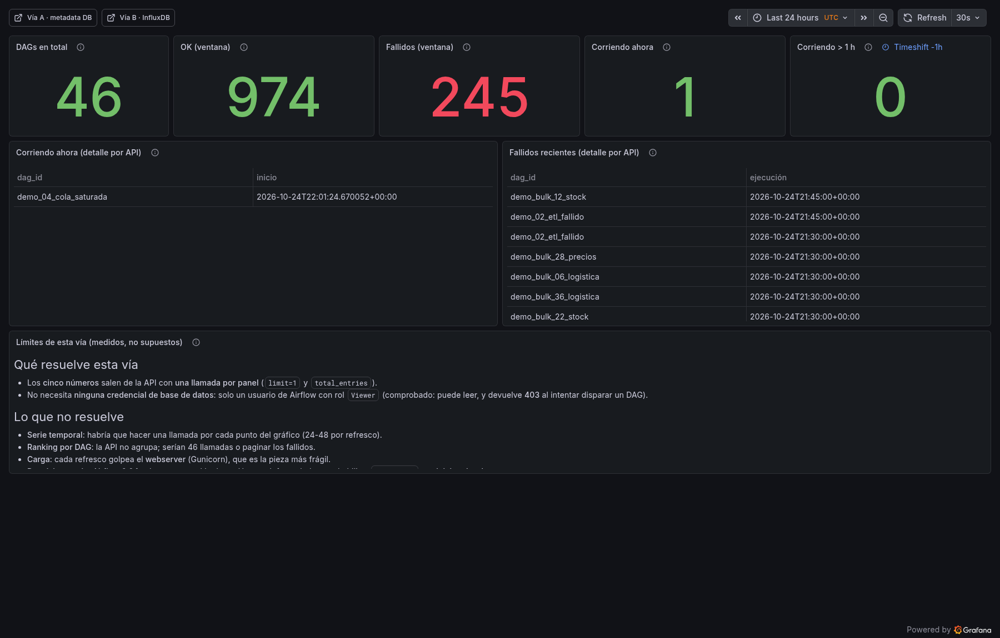

# 13 · Tercera opción: consultar la API REST de Airflow

> Pregunta legítima: si Airflow tiene API, ¿por qué no leer de ahí en vez de la base de datos?
> Respuesta corta: **se puede, los números salen idénticos** (probado aquí), pero cuesta tres cosas
> que las otras dos opciones no cuestan.

## Lo que se probó (en el Airflow 2.8.1 de este laboratorio)

Primero, un hallazgo que decide medio análisis: **la API de Airflow 2.8.1 no acepta acceso
programático por defecto.**

```bash
$ airflow config get-value api auth_backends
airflow.api.auth.backend.session          # ← solo cookie de sesión (navegador)
$ curl -s -o /dev/null -w '%{http_code}' http://localhost:8085/api/v1/dags
401
```

Para consultarla desde un programa hay que **cambiar configuración y reiniciar el webserver**:

```bash
AIRFLOW__API__AUTH_BACKENDS="airflow.api.auth.backend.basic_auth,airflow.api.auth.backend.session"
# o JWT:  airflow.api.auth.backend.jwt_token  +  POST /auth/token
```

Eso ya contradice la ventaja principal de la opción A ("no se toca Airflow").

## Los cinco KPIs por API, medidos

Con `basic_auth` habilitado, cada KPI es **una sola llamada** con `limit=1`: la respuesta trae
`total_entries`, que es el conteo. No hace falta paginar.

| KPI | Llamada | Resultado real | ¿Coincide con SQL? |
|---|---|---|---|
| DAGs totales | `GET /api/v1/dags?limit=1` | `total_entries: 46` | sí (46) |
| Corriendo ahora | `GET /api/v1/dags/~/dagRuns?state=running&limit=1` | `1` | sí (1) |
| Exitosos 24 h | `.../dagRuns?state=success&execution_date_gte=<ISO>` | `796` | sí (796) |
| Fallidos 24 h | `.../dagRuns?state=failed&execution_date_gte=<ISO>` | `186` | sí (186) |
| Corriendo > 1 h | `.../dagRuns?state=running&start_date_lte=<ISO>` | `0` (filtro válido, HTTP 200) | sí |

Comprobación cruzada en la base, en el mismo minuto:

```sql
SELECT state, count(*) AS total,
       count(*) FILTER (WHERE execution_date > now() - interval '24 hours') AS ult24h
FROM dag_run GROUP BY state;
--  success | 4456 | 796
--  failed  |  723 | 186
--  running |    1 |    1
```

**Conclusión técnica: la API devuelve exactamente lo mismo que el SQL.** El filtro
`start_date_lte` existe y funciona en 2.8.1 (no hay que paginar todo para encontrar los lentos).

## Cómo se montaría en Grafana

Grafana no habla HTTP/JSON de forma nativa: necesita el plugin **Infinity**
(`yesoreyeram-infinity-datasource`), que hace la llamada y parsea el JSON.

```yaml
datasources:
  - name: Airflow API
    uid: airflow-api
    type: yesoreyeram-infinity-datasource
    jsonData:
      auth_method: basicAuth
    secureJsonData:
      basicAuthUser: grafana_ro_api
      basicAuthPassword: <token o password>
```

Un panel, tipo Infinity con `parser: backend`, `url: /api/v1/dags/~/dagRuns`,
`url_options.params: [state=running, limit=1]`, y `root_selector: total_entries`.

## Los tres costes que hay que decir en voz alta

**1 · Necesita una credencial de Airflow, y esa credencial puede más de lo que debe.**
La API no tiene un rol "solo lectura de métricas": se autentica con un usuario de Airflow. Si se
usa el admin, Grafana puede **disparar DAGs, pausarlos y borrar runs**. Hay que crear un usuario
con rol `Viewer` y usar ese. Es un trabajo extra que la opción A no necesita (allí el rol SQL solo
puede hacer `SELECT`).

**2 · La carga va al webserver, que es la pieza más frágil.**
Cada panel = mínimo una llamada HTTP cada 30 s. El webserver (Gunicorn) comparte CPU con el
scheduler y es lo primero que se cae cuando el clúster aprieta. La opción A carga la base; la C
carga el webserver.

**3 · Dos de los doce paneles no se pueden hacer (o salen carísimos).**

| Panel | Por API |
|---|---|
| Serie temporal "runs por estado" | una llamada **por cada punto** (24 h = 24–48 llamadas por refresco) → inviable |
| "Top 10 DAGs con más fallos" | la API no agrupa: 46 llamadas (una por `dag_id`) o paginar los 186 fallidos |
| Tablas de detalle | sí, con una llamada por estado y paginación de hasta 100 |

Es decir: la opción C sirve para los **cinco números**, no para el tablero completo.

## Tabla de las tres opciones

| | A · metadata DB | B · InfluxDB | C · API REST |
|---|---|---|---|
| Cambios en Airflow | **ninguno** | ninguno | **config + reinicio del webserver** |
| Credencial que guarda Grafana | rol SQL `SELECT` | token de Influx | usuario de Airflow (RBAC) |
| Números | exactos | muestreados cada 30 s | exactos |
| Serie temporal | sí (SQL `date_trunc`) | sí (nativa) | **no viable** |
| Detalle por DAG | sí | parcial | paginando |
| Carga añadida | a la base | al colector | **al webserver** |
| Sobrevive a la caída del clúster | no | **sí** | no |
| Historia | la no purgada | propia | la no purgada |
| Plugin de Grafana | no (core) | no (core) | **sí (Infinity)** |
| Esfuerzo | 3-4 jornadas | +1-2 | +1-2 (y depende de RBAC del cliente) |

## Cuándo elegir C

Hay dos escenarios donde C es la **mejor** opción, y no son raros:

1. **El equipo de base de datos no da credenciales** (política de "nadie se conecta al Postgres de
   producción"). Con C no hace falta tocar la base.
2. **La base no es alcanzable pero el webserver sí** (base en subred privada, webserver publicado
   por Ingress). Ahí A es imposible sin abrir red.

En cualquiera de los dos, el alcance se reduce a **los cinco paneles de conteo**; la serie temporal
y el ranking habría que resolverlos de otra forma (o con la opción B en paralelo).

## Decisión

**No entra en el MVP.** Si el cliente pone como condición "nada de credenciales de base de datos",
se ofrece C con el alcance recortado (5 paneles) y se le explica qué se pierde. Si además quiere el
tablero completo, entonces la conversación correcta es A con una réplica de lectura o B.

## Implementado en el laboratorio: el tercer dashboard

Sí se montó, y funciona: **`/d/airflow-api`** (8 paneles), leyendo solo de la API con el plugin
Infinity y el usuario `grafana_api` (rol `Viewer`).



Verificación automática (`scripts/verify_api.py`), con los valores de ese momento:

```text
DASHBOARD  airflow-api · 8 paneles · Airflow 2.8.1 · Vía C (API REST)
[ OK ]  1 DAGs en total                          filas=1 cols=['n'] [46]
[ OK ]  2 OK (ventana)                           filas=1 cols=['n'] [974]
[ OK ]  3 Fallidos (ventana)                     filas=1 cols=['n'] [245]
[ OK ]  4 Corriendo ahora                        filas=1 cols=['n'] [1]
[ OK ]  5 Corriendo > 1 h                        filas=1 cols=['n'] [0]
[ OK ]  6 Corriendo ahora (detalle por API)      filas=1 ['demo_04_cola_saturada', '2026-10-24T22:01:24']
[ OK ]  7 Fallidos recientes (detalle por API)   filas=50 ['demo_bulk_12_stock', '2026-10-24T21:45:00']
RESULTADO: 8 paneles, 0 con problema
```

### Las cinco trampas que costó encontrar (para no repetirlas)

1. **`parser: "backend"`.** Sin eso, Infinity devuelve frames vacíos aunque la llamada sea 200.
2. **Escalares sin `root_selector`**: con `parser: backend` y una columna
   `{"selector": "total_entries", "type": "number"}` sale el número. Con `root_selector` puesto,
   devuelve vacío.
3. **Arrays con `root_selector`**: para `/dagRuns` hay que poner `root_selector: "dag_runs"`
   (la clave del JSON), o las columnas llegan a `null`.
4. **`$__env{}` no se interpola dentro de `secureJsonData`.** El header de autorización se escribe
   ya calculado por `bootstrap.sh` en `airflow-api.yaml`, y ese fichero está **en `.gitignore`**
   porque contiene la credencial. En el repo queda la plantilla
   `airflow-api.yaml.example` con el hueco `__BASIC_B64__`.
5. **`basicAuth` nativo de Infinity v4 no envió la credencial** contra esta API (401 con la misma
   contraseña que `curl` autentica bien). Se usa el header `Authorization` explícito, que sí
   funciona.

Dos que sí funcionaron a la primera y conviene saber:

- **`${__from:date:iso}` se interpola** en los parámetros: sirve para `execution_date_gte`.
- **`timeShift: "1h"`** en el panel hace que `${__to}` valga "ahora menos 1 hora": así se resuelve
  "corriendo > 1 h" sin cálculos de fechas. Se ve como insignia en el propio panel.

### Cómo se regenera

```bash
python3 scripts/generate_dashboard_api.py > grafana/dashboards/airflow-api.json
GRAFANA_PASS=$(grep '^GRAFANA_ADMIN_PASSWORD=' .env | cut -d= -f2) python3 scripts/verify_api.py
```

### Qué NO tiene este dashboard (y es a propósito)

- **No hay serie temporal**: la API no agrega por intervalo. Sería una llamada por punto.
- **No hay ranking por DAG**: serían 46 llamadas, una por `dag_id`.
- **No sobrevive a la caída del clúster** (como la vía A): lee del webserver.

Es decir: la vía C es una demostración honesta de que **los cinco números se pueden sacar sin
credenciales de base de datos**, y de lo que cuesta el resto del tablero.
